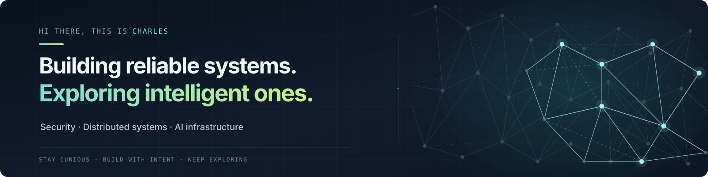

  

  <a href="https://github.com/charlesxc4">
    <picture>
      <source media="(prefers-color-scheme: dark)"
              srcset="https://cdn.simpleicons.org/github/FFFFFF">
      
    </picture>
  </a>
  &nbsp;&nbsp;
  

---

## 👋 About me

Hey, I'm Charles! I'm a software engineer who loves exploring how things work under the hood — especially in **cybersecurity, distributed systems, and AI**.

I enjoy tackling tricky problems, experimenting with new technologies, and building things just to see what's possible. Lately, I've been diving into AI agents, local LLMs, and the occasional technology rabbit hole.

Always curious, always building.

## 🧭 Engineering Focus

### 🔐 Security Engineering
Exploring how to build safer systems, protect sensitive data, and detect sophisticated threats.
- Cybersecurity & Threat Detection
- Data Protection & Security Investigation
- AI Security

### ⚙️ Distributed Systems
Building and understanding reliable systems that operate at scale.
- Large-Scale Data Processing
- Backend Infrastructure & System Design
- Reliability & Fault Tolerance

### 🤖 AI Infrastructure
Exploring the infrastructure and architecture behind intelligent applications.
- AI Agents & Multi-Agent Systems
- LLM Inference & Model Serving
- RAG, Retrieval & Local AI

## 🔬 Currently Exploring

I'm always experimenting with new ideas and technologies. Here are a few things I'm spending time exploring lately:

- 🤖 **AI Agents** — Agent orchestration, memory, tool use, and multi-agent systems.
- 🧠 **Local AI** — LLM inference, model serving, and building a multi-model environment locally.
- 🔐 **AI & Security** — AI security, emerging threats, and the intersection of intelligent systems and cybersecurity.

Always learning, experimenting, and occasionally going down another rabbit hole.

---

  Stay curious. Build carefully. Make the complicated feel simple.

